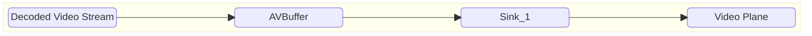
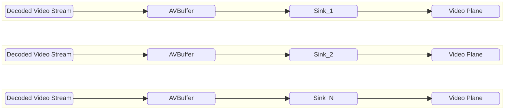
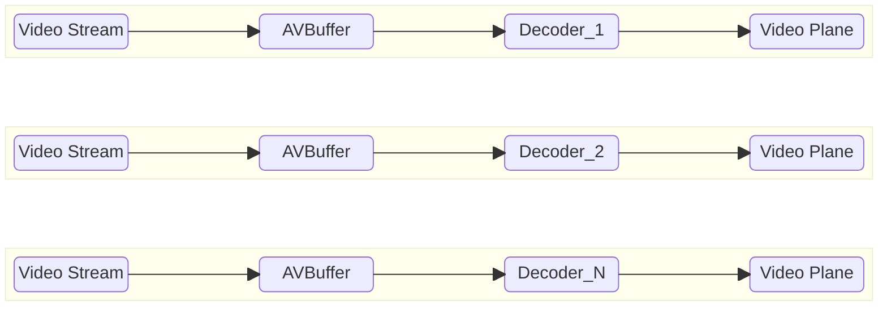

# Video Sink High Level Test Specification Document

## Table of Contents

- [Acronyms, Terms and Abbreviations](#acronyms-terms-and-abbreviations)
- [Introduction](#introduction)
- [Module Description](#module-description)
- [L2 Test Specification](#l2-test-specification)
- [L3 Test Specification](#l3-test-specification)

## Acronyms, Terms and Abbreviations

- `HAL`    - Hardware Abstraction Layer
- `API`    - Application Programming Interface
- `AIDL`   - Android Interface Definition Language
- `L2`     - Level 2 Testing
- `L3`     - Level 3 Testing
- `NA`     - Not Applicable
- `Caller` - Any user of the interface via the `APIs`
- `CB`     - Call-back function (suffix)
- `RDK`    - Reference Design Kit
- `EOS`    - End of Stream

## Introduction

This document provides an overview of the testing requirements for the Video Sink module. It outlines the scope of testing, objectives, testing levels and approaches, specific test requirements.

- Video Sink Interface Definitions - [Video Sink HAL](https://github.com/rdkcentral/rdk-halif-aidl/tree/v0.6/videosink/current/com/rdk/hal/videosink)

- Video Sink Overview - [Video Decoder Overview](https://wiki.rdkcentral.com/display/RDKHAL/Video+Sink)

## Module Description
The Video Sink `HAL` service provides the interfaces for the video frame queue and deliver video frames to a video plane under the timing of the vendor AV sync.

## L2 Test Specification

|Test|Description|HAL APIs|
|----|-----------|--------|
|Set and Get Video Sink Properties|<ul><li>Read available Video Sinks using `IVideoSinkManager` class</li><li>Loop through available video sinks</li><li>Use the `setProperty` method to set all the supported value provided in [configuration YAML](../../profiles/videosink-properties.yaml)</li><li>Get the property value using `getProperty` of `IVideoSink` and verify the HAL returns the set Value from the YAML file</li></ul>|<ul><li>IVideoSinkManager - getVideoSinkIds, getVideoSink</li><li>IVideoSink - open, getProperty, close </li><li>IVideoSinkController - setProperty</li></ul>|
|States of VideoSink|<ul><li>Read supported video sinks using `IVideoSinkManager` class calling `getVideoSinkIds`</li><li>Loop through supported video sinks</li><li>register  event listeners using `registerEventListener`</li><li>Ensure state transitions (`opening-> Ready-> Starting-> started -> Flushing-> started-> stopping -> closing -> Closed`)</li><li>call `open` in `IVideoSinkController` to transition to the state `READY`</li><li>Observe the `OnStateChangeEvent` in the  `IVideoSinkEventListener` to get `OPENING` and `READY` states</li> <li>Once in `READY` state query the Sink state using `getState` and verify</li><li>call `start` in `IVideoSinkController` to transition to the state `STARTED`</li><li>Observe the `OnStateChangeEvent` in the  `IVideoSinkEventListener` to get `STARTING` and `STARTED` states</li> <li>Once in `STARTED` state query the Sink state using `getState` and verify</li><li>call `flush` in `IVideoSinkController` to go through transitioning state `FLUSHING`</li><li>Observe the `OnStateChangeEvent` in the  `IVideoSinkEventListener` to get `FLUSHING` and `STARTED` states</li> <li>Once in `STARTED` state query the Sink state using `getState` and verify</li><li>call `close` in `IVideoSinkController` to transition to the state `CLOSED`</li><li>Observe the `OnStateChangeEvent` in the  `IVideoSinkEventListener` to get `STOPPING`, `CLOSING` and `CLOSED` states</li> <li>Once in `CLOSED` state query the Sink state using `getState` and verify</li></ul>|<ul><li>IVideoSinkManager - getVideoSinkIds, getVideoSink</li><li>IVideoSink - open, getState, registerEventListener, unregisterEventListener, close </li><li>IVideoSinkController - start, stop, flush</li></ul>|

### L3 Test Specification
### Prerequisites

#### Video Decoder

Decoded Video frames are supplied to the Video Sink queue during non-tunneled mode testing, which necessitates a pre-validated Video Decoder module. Therefore, the VideoDecoder must successfully pass VTS L1, L2, and L3 testing before being used in the Video Sink tests

#### AV Buffer

Av buffer provides frames buffers to the Video sink during non-tunneled testing, which necessitates a pre-validated AVBuffer module. Therefore, the AVBuffer must successfully pass VTS L1, L2, and L3 testing before being used in the Video Sink tests

### Feature List

VTS L3 validates all the Video Sink features in both sequential and concurrent modes (if the platform supports multiple sinks) as represented below.

#### Sequential Decoding

The Sequential Decoding test evaluates each video sink individually, one after another, to ensure functional correctness across all supported features. This approach helps isolate issues and verify that every sink instance performs as expected in a standalone environment.

##### Non-Tunneled
In non-tunnel mode Decoder should set Sink to nom-tunnel mode, Decoded video frames are passed to the linked video sink via AVbuffer for rendering.

##### Tunneled
In tunnel mode Decoder should set Sink to tunnel mode, Decoded video frames are passed directly to the linked video plane for rendering.

#### Concurrent Decoding

The Concurrent Decoding test assesses the system's ability to handle multiple video sink operating simultaneously, each configured with different supported features. This test is designed to validate the robustness, resource management, and feature compatibility of the platform under concurrent load, and is applicable only if the platform supports multiple sink instances.

##### Non-Tunneled

##### Tunneled
In tunnel mode Decoder should set Sink to tunnel mode, Decoded video frames are passed directly to the linked video plane for rendering.

The following table outlines the core features validated in the L3 test phase

|#|Testing Feature|Description|
|-|---------------|-----------|
|1|Tunnel/Non-Tunnel|Executes the sink in tunnel mode. Based on video decoder configuration, the sink chooses between tunnel and non-tunnel operation. In tunnel mode, the test validates only metrics.|
|2|Render First Frame|Test the sink's capability to send `onFirstFrameRendered` callback event with presentation time on First frame rendering.|
|3|EOS|Test the sink's handling of an `eos` (end-of-stream) signal. sink should raise an event call back on receiving `eos` frame.|
|4|Underflow|Test the sink's handling of video underflow. Sink should be able to raise event during video buffer underflow condition. |
|5|Video Resume|Verifies Sink can resume video playback after an underflow occurred in the video buffer. Sink should be able to raise event `onVideoResumed` during video buffer underflow condition.|
|6|Flush without hold last frame|Test the sinks's flush functionality. The sink discard any buffers already queued and resume normal playback of subsequent frames without displaying the last frame till new frame is received. Sink will raise an event `onFlushComplete`|
|7|Flush with hold last frame|Test the sink’s flush functionality combined with hold last frame. The sink should discard all queued buffers amd resume playback of subsequent frame by displaying the last frame till new frame is received. Sink will raise an event `onFlushComplete`|
|8|Discard Frame Till|Test the sink's ability to discard the incoming frames till the specified presentation time|
|9|Queue Depth|This test verifies the sink's queue depth by reading the metric property|
|10|Frames Dropped| This test verifies the metric data read form the sink's property to know how many framed are dropped during playback|
|11|Frames Dropped due to frame rate change| This test verifies the metric data read form the sink's property to know how many framed are dropped becaus of frame rate change in stream during playback |
|12|Frames Repeated due to frame rate change | This test verifies the metric data read form the sink's property to know how many framed are repeated during playback |
|13|Multi Instance|If platform supports multiple sinks, test executes multiple sinks simultaneously, validating outputs and their respective metrics.|

|#|Test|Tunnel|Render First Frame|EOS|Underflow|Video Resume|Flush|Flush+Hold Last Frame|Discard Frame Till|Queue Depth|Frames Dropped|Frames Dropped due to frame rate change|Frames Repeated due to frame rate change|Multi Instance|
|-|----|------|------------------|---|---------|------------|-----|---------------------|------------------|-----------|--------------|---------------------------------------|----------------------------------------|--------------|
|1|Sink_Sequential_NonTunnel|✘|✘|✘|✘|✘|✘|✘|✘|✘|✘|✘|✘|✘|
|2|Sink_Sequential_NonTunnel_RenderFirstFrame|✘|✔|✘|✘|✘|✘|✘|✘|✘|✘|✘|✘|✘|
|3|Sink_Sequential_NonTunnel_EOS|✘|✘|✔|✘|✘|✘|✘|✘|✘|✘|✘|✘|✘|
|4|Sink_Sequential_NonTunnel_Underflow|✘|✘|✘|✔|✘|✘|✘|✘|✘|✘|✘|✘|✘|
|5|Sink_Sequential_NonTunnel_VideoResume|✘|✘|✘|✘|✔|✘|✘|✘|✘|✘|✘|✘|✘|
|6|Sink_Sequential_NonTunnel_Flush|✘|✘|✘|✘|✘|✔|✘|✘|✘|✘|✘|✘|✘|
|7|Sink_Sequential_NonTunnel_FlushHoldFrame|✘|✘|✘|✘|✘|✘|✔|✘|✘|✘|✘|✘|✘|
|8|Sink_Sequential_NonTunnel_DiscardFrameTill|✘|✘|✘|✘|✘|✘|✘|✔|✘|✘|✘|✘|✘|
|9|Sink_Sequential_NonTunnel_QueueDepth|✘|✘|✘|✘|✘|✘|✘|✘|✔|✘|✘|✘|✘|
|10|Sink_Sequential_NonTunnel_FramesDropped|✘|✘|✘|✘|✘|✘|✘|✘|✘|✔|✘|✘|✘|
|11|Sink_Sequential_NonTunnel_FramesDroppedForFRC|✘|✘|✘|✘|✘|✘|✘|✘|✘|✘|✔|✘|✘|
|12|Sink_Sequential_NonTunnel_FramesRepeatedForFRC|✘|✘|✘|✘|✘|✘|✘|✘|✘|✘|✘|✔|✘|
|13|Sink_Sequential_Tunnel|✔|✘|✘|✘|✘|✘|✘|✘|✘|✘|✘|✘|✘|
|14|Sink_Sequential_Tunnel_RenderFirstFrame|✔|✔|✘|✘|✘|✘|✘|✘|✘|✘|✘|✘|✘|
|15|Sink_Sequential_Tunnel_EOS|✔|✘|✔|✘|✘|✘|✘|✘|✘|✘|✘|✘|✘|
|16|Sink_Sequential_Tunnel_Underflow|✔|✘|✘|✔|✘|✘|✘|✘|✘|✘|✘|✘|✘|
|17|Sink_Sequential_Tunnel_VideoResume|✔|✘|✘|✘|✔|✘|✘|✘|✘|✘|✘|✘|✘|
|18|Sink_Sequential_Tunnel_Flush|✔|✘|✘|✘|✘|✔|✘|✘|✘|✘|✘|✘|✘|
|19|Sink_Sequential_Tunnel_FlushHoldFrame|✔|✘|✘|✘|✘|✘|✔|✘|✘|✘|✘|✘|✘|
|20|Sink_Sequential_Tunnel_DiscardFrameTill|✔|✘|✘|✘|✘|✘|✘|✔|✘|✘|✘|✘|✘|
|21|Sink_Sequential_Tunnel_QueueDepth|✔|✘|✘|✘|✘|✘|✘|✘|✔|✘|✘|✘|✘|
|22|Sink_Sequential_Tunnel_FramesDropped|✔|✘|✘|✘|✘|✘|✘|✘|✘|✔|✘|✘|✘|
|23|Sink_Sequential_Tunnel_FramesDroppedForFRC|✔|✘|✘|✘|✘|✘|✘|✘|✘|✘|✔|✘|✘|
|24|Sink_Sequential_Tunnel_FramesRepeatedForFRC|✔|✘|✘|✘|✘|✘|✘|✘|✘|✘|✘|✔|✘|
|25|Sink_MultiInstance_NonTunnel|✘|✘|✘|✘|✘|✘|✘|✘|✘|✘|✘|✘|✔|
|26|Sink_MultiInstance_NonTunnel_RenderFirstFrame|✘|✔|✘|✘|✘|✘|✘|✘|✘|✘|✘|✘|✔|
|27|Sink_MultiInstance_NonTunnel_EOS|✘|✘|✔|✘|✘|✘|✘|✘|✘|✘|✘|✘|✔|
|28|Sink_MultiInstance_NonTunnel_Underflow|✘|✘|✘|✔|✘|✘|✘|✘|✘|✘|✘|✘|✔|
|29|Sink_MultiInstance_NonTunnel_VideoResume|✘|✘|✘|✘|✔|✘|✘|✘|✘|✘|✘|✘|✔|
|30|Sink_MultiInstance_NonTunnel_Flush|✘|✘|✘|✘|✘|✔|✘|✘|✘|✘|✘|✘|✔|
|31|Sink_MultiInstance_NonTunnel_FlushHoldFrame|✘|✘|✘|✘|✘|✘|✔|✘|✘|✘|✘|✘|✔|
|32|Sink_MultiInstance_NonTunnel_DiscardFrameTill|✘|✘|✘|✘|✘|✘|✘|✔|✘|✘|✘|✘|✔|
|33|Sink_MultiInstance_NonTunnel_QueueDepth|✘|✘|✘|✘|✘|✘|✘|✘|✔|✘|✘|✘|✔|
|34|Sink_MultiInstance_NonTunnel_FramesDropped|✘|✘|✘|✘|✘|✘|✘|✘|✘|✔|✘|✘|✔|
|35|Sink_MultiInstance_NonTunnel_FramesDroppedForFRC|✘|✘|✘|✘|✘|✘|✘|✘|✘|✘|✔|✘|✔|
|36|Sink_MultiInstance_NonTunnel_FramesRepeatedForFRC|✘|✘|✘|✘|✘|✘|✘|✘|✘|✘|✘|✔|✔|
|37|Sink_MultiInstance_Tunnel|✔|✘|✘|✘|✘|✘|✘|✘|✘|✘|✘|✘|✔|
|38|Sink_MultiInstance_Tunnel_RenderFirstFrame|✔|✔|✘|✘|✘|✘|✘|✘|✘|✘|✘|✘|✔|
|39|Sink_MultiInstance_Tunnel_EOS|✔|✘|✔|✘|✘|✘|✘|✘|✘|✘|✘|✘|✔|
|40|Sink_MultiInstance_Tunnel_Underflow|✔|✘|✘|✔|✘|✘|✘|✘|✘|✘|✘|✘|✔|
|41|Sink_MultiInstance_Tunnel_VideoResume|✔|✘|✘|✘|✔|✘|✘|✘|✘|✘|✘|✘|✔|
|42|Sink_MultiInstance_Tunnel_Flush|✔|✘|✘|✘|✘|✔|✘|✘|✘|✘|✘|✘|✔|
|43|Sink_MultiInstance_Tunnel_FlushHoldFrame|✔|✘|✘|✘|✘|✘|✔|✘|✘|✘|✘|✘|✔|
|44|Sink_MultiInstance_Tunnel_DiscardFrameTill|✔|✘|✘|✘|✘|✘|✘|✔|✘|✘|✘|✘|✔|
|45|Sink_MultiInstance_Tunnel_QueueDepth|✔|✘|✘|✘|✘|✘|✘|✘|✔|✘|✘|✘|✔|
|46|Sink_MultiInstance_Tunnel_FramesDropped|✔|✘|✘|✘|✘|✘|✘|✘|✘|✔|✘|✘|✔|
|47|Sink_MultiInstance_Tunnel_FramesDroppedForFRC|✔|✘|✘|✘|✘|✘|✘|✘|✘|✘|✔|✘|✔|
|48|Sink_MultiInstance_Tunnel_FramesRepeatedForFRC|✔|✘|✘|✘|✘|✘|✘|✘|✘|✘|✘|✔|✔|